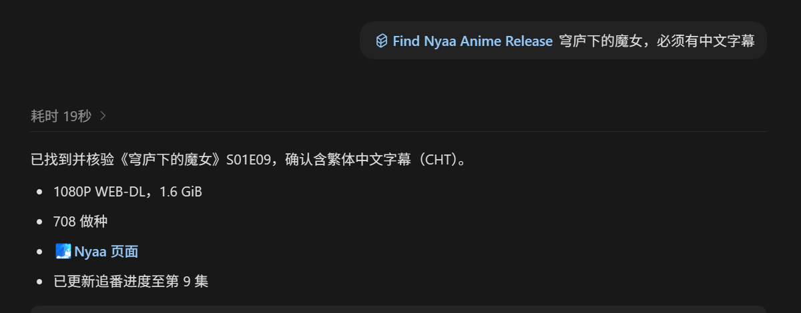
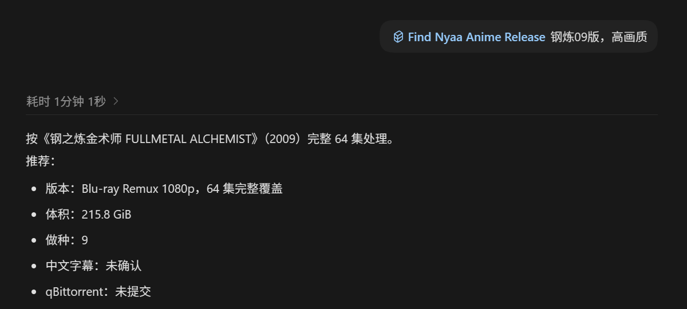
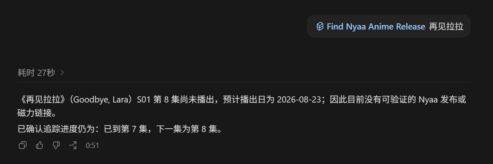
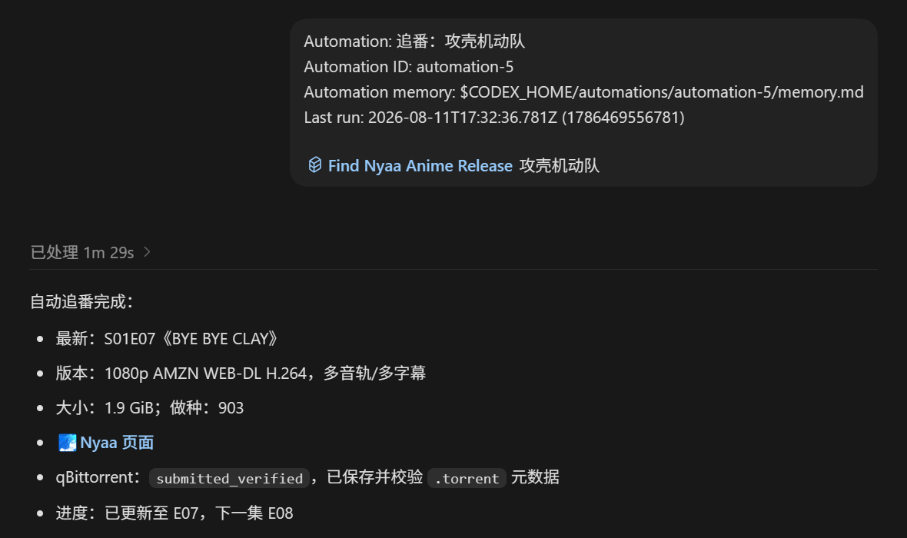
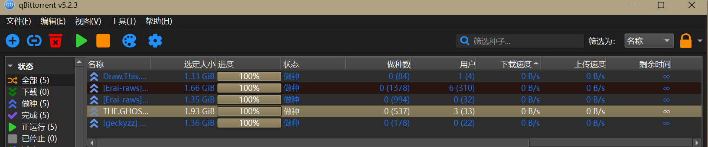
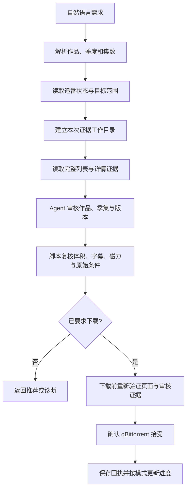

# Find Nyaa Anime Release

<p align="center">
  <strong>让本地 Agent 识别动画、筛选画质与字幕、记录新番进度，并返回经过验证的 Nyaa 发布。</strong>
</p>

<p align="center">
  
  
  
</p>



你只需要用自然语言说明动画、季度、集数、画质或字幕要求。Skill 会解析作品身份，比较 Nyaa 候选，检查季集、体积、字幕和磁力，再把合格结果交给你。

本项目以 **Codex 作为设计基准和主要验证环境**，下文也以 Codex 演示安装与使用。交互检索、证据验证和下载由 Markdown 指令与本地 Python 脚本配合完成。其他具备相应工具能力的 Agent 可以尝试直接使用，或按其路径、权限与调用方式做少量调整；定时任务还需要适配宿主的调度和配置接口。

## 能做什么

- 识别中文名、简称、英文名和罗马字名，区分季度、正篇、特典、剧场版与合集。
- 支持最新一集、指定集、追番下一集、整季包和电影。
- 默认只检索 Nyaa；其他站点可用于核实作品身份和播出信息，不会自动变成下载来源。
- Agent 阅读完整的时间顺序列表与候选详情，判断作品、季集和版本；脚本复核体积、字幕和资源标识。
- 画质比较依据候选详情页与完整文件列表；体积、编码标签和发布组名本身不代表画质优势。
- 默认偏好中文字幕；只有明确提出“必须有中文字幕”时才将其作为硬条件验证。
- 返回最终推荐前验证磁力，不把失败或不合格候选暴露给用户。
- 为新番维护交付进度，也可按明确要求为尚未开播的新番建定时任务；老番、电影、特典和失败检索不推进追番记录。
- 可选将最终结果提交到本机 qBittorrent，也可用于定时追番任务；下文以 Codex Automations 为例。

## 安装（以 Codex 为例）

在 Codex 中运行：

```text
$skill-installer install https://github.com/divisioncassini05-lab/find-nyaa-anime-release/tree/main/skills/find-nyaa-anime-release
```

安装后新建一个 Codex 任务即可使用。

### 手动安装

1. 下载本仓库 ZIP 并解压。
2. 将 `skills/find-nyaa-anime-release` 整个文件夹复制到：
   - Windows：`C:\Users\你的用户名\.codex\skills\find-nyaa-anime-release`
   - macOS / Linux：`~/.codex/skills/find-nyaa-anime-release`
3. 重新打开 Codex，或新建一个任务。

### 其他 Agent

将 `skills/find-nyaa-anime-release` 目录接入 Agent 的自定义指令或 Skill 机制，并确保它能够：

- 读取 `SKILL.md`；
- 调用目录内的 Python 脚本；
- 访问本地状态文件和网络。

不同 Agent 的 Skill 目录、命令权限和触发语法并不统一。交互检索可从 `SKILL.md` 的对应入口开始；自动追番还需调度工具提供创建、读回、更新和删除能力，并适配现有任务配置、归属绑定及完结清理。当前配置读取以 Codex 的 `automation.toml` 为基础，其他宿主尚未逐一验证。

发布模板默认使用安装者的当前聊天或其明确指定的追番聊天，不包含作者个人的聊天 ID；模型沿用目标聊天或任务当前的选择，不硬编码型号。

## 直接这样说

```text
$find-nyaa-anime-release Re0
$find-nyaa-anime-release 穹庐下的魔女，必须有中文字幕
$find-nyaa-anime-release 零之使魔第二季，高画质
$find-nyaa-anime-release CLANNAD，全系列
$find-nyaa-anime-release 魔法少女小圆：叛逆的物语，高画质
$find-nyaa-anime-release 攻壳机动队，找到后提交 qBittorrent
```

不写季度或集数时，Skill 会结合作品身份和本地追番状态判断；存在真正歧义时才会询问。

新番交互检索沿用已保存的默认配置，完成审核后按下载授权执行，不额外要求挑选候选。老番通常先展示 2–4 个已核验的合格选项，说明覆盖、体积、字幕和可用性，等你选定后再提交；明确说“按默认来”或指定某个版本时遵循你的选择。只查资源、只要磁力或不下载的要求始终优先。

## 画质档位

| 说法 | 默认范围 | 说明 |
| --- | ---: | --- |
| 轻量观看 / 随便看看 | 1–2 GiB/集 | 绝对下限 1 GiB；区间内不按体积大小加分 |
| 普通观看 / 一般画质 / 中等画质 | 2–4 GiB/集 | 明确范围优先；放宽范围需要请求或模板明确允许 |
| 高画质 / 极致画质 / 最高画质 | ≥6 GiB/集 | 可接受有证据的 BDMV、Remux 或同级无损来源；兼容范围需要明确允许 |
| 电影 | ≥10 GiB 总大小 | 用户明确给出的范围优先 |

未指定画质时默认轻量观看。体积是筛选条件，不等于对实际观感的保证；还会结合片源、编码和发布证据判断。普通正篇默认不低于 `1 GiB/集`，电影默认不低于 `10 GiB`。自定义上下限请明确说明，字幕要求或检索失败不会自动降低门槛。

合格候选有明确的画面优势时优先采用该优势；差异小或证据不足时，再比较已确认的中文字幕、可用性和用户指定的发布组偏好。没有对比证据就说明未知，不把更大的文件或 Remux 标签直接当作更好的画质。

“允许向上兼容”表示在当前档位没有合格结果时，可以接受更大的资源；显式上限仍然有效。新番交互与定时任务沿用已保存的默认配置，其中包含向上兼容；其他交互请求需明确允许。整季包另按文件列表核验覆盖和逐集最低线，不能仅凭总大小判断。草稿、审核、交付和恢复保持同一份质量条件，不自动降档。

## 实际效果

### 整季与高画质

*注：为便于展示，截图裁去了下方的磁力链接；实际检索成功时会直接返回完整磁力链接。*
不会把任意单集或番外当成整季结果；整季包会检查覆盖范围和来源等级。



### 下一集尚未播出

目标集没播时会明确报告，并保留当前进度，不拿上一集冒充最新结果。



### 自动追番与下载

定时任务可以确认最新正篇、验证发布、提交 qBittorrent，再按结果更新下一集。

新建追番任务使用[定时追更模板](skills/find-nyaa-anime-release/references/scheduled-new-anime.md)：默认将合格资源加入 qBittorrent；临时未更新时在同一任务中每隔 4 小时补查，最多 3 次，随后恢复常规计划。明确只查资源或只要磁力时按你的要求执行。已存在的任务不会因安装更新而自动改写。

调度器若提前不超过 5 分钟唤醒，会在本轮等待到计划时间再检查，不消耗补查次数。临时连接中断可按既有规则有限补查；证书、权限或执行环境问题需要先排查，不会盲目重试。

已完结作品不新建周期追番：没有指定未来时间时走一次性检索或导入；明确指定未来时间时只按一次性任务处理。宿主不支持一次性任务时会说明限制，不擅自改成每周任务。





qBittorrent 提交是可选功能。普通搜索不要求安装 qBittorrent。“已加入客户端”表示客户端接受了该任务；实际传输、下载完成和已观看是不同状态。

Windows 桌面提交会比较已发现安装的文件版本，优先选择可核验的较新版本；显式路径优先。若另一套安装仍在运行，会报告冲突。新启动通过本地 WMI 创建独立进程，以避免客户端随命令执行器退出；更新 Skill 不会改变已运行进程的启动方式。配置和传输问题按[客户端诊断流程](skills/find-nyaa-anime-release/references/client-readiness.md)处理。

## 工作方式



Agent 审核候选并按当前交互规则完成选择，脚本验证结论与页面证据是否一致。每次添加任务前，都需重新验证原质量条件、资源 hash 和详情；直接提交裸磁力或拿一份“已通过”的 JSON 不能替代审核流程。下载时，匹配的客户端接受回执和成功提交的状态共同构成交付结果；失败后按原操作和资源 hash 恢复。查资源或只返回磁力时不推进交付进度。本文截图与操作示例使用 Codex。

### 结构与入口

`SKILL.md` 负责选择流程，共用规则保持简短；具体步骤按需加载。

| 场景或模块 | 入口 |
| --- | --- |
| 交互检索、指定集、下一集或最新集 | [retrieval-workflow.md](skills/find-nyaa-anime-release/references/retrieval-workflow.md) |
| 填写候选审核、验证和交付 | [agent-review.md](skills/find-nyaa-anime-release/references/agent-review.md) |
| 整季／电影的审核、交付和恢复 | [package-review.md](skills/find-nyaa-anime-release/references/package-review.md)、`scripts/package_release.py` |
| 体积门槛与画质比较 | [quality-ranking.md](skills/find-nyaa-anime-release/references/quality-ranking.md) |
| 创建或修改定时任务 | [scheduled-new-anime.md](skills/find-nyaa-anime-release/references/scheduled-new-anime.md) |
| 定时执行与按需补查 | [scheduled-run.md](skills/find-nyaa-anime-release/references/scheduled-run.md)、[scheduled-retry.md](skills/find-nyaa-anime-release/references/scheduled-retry.md) |
| 客户端环境与下载异常 | [client-readiness.md](skills/find-nyaa-anime-release/references/client-readiness.md) |
| 恢复与完结清理 | [failure-recovery.md](skills/find-nyaa-anime-release/references/failure-recovery.md)、[completion.md](skills/find-nyaa-anime-release/references/completion.md) |
| 当前状态、审核、交付命令 | `scripts/watch.py` 和 `scripts/watch_v3/` |
| 保留的兼容检索入口与报告 | `scripts/find_anime_release.py`、[retrieval-core-v2.md](skills/find-nyaa-anime-release/references/retrieval-core-v2.md) |

v3 是追番状态的唯一写入入口。`anime_release/` 等共用模块和兼容入口仍有调用方；它们不代表第二套可独立推进的追番记录。

整季／电影使用独立交付日志保留原请求、审核和回执，以便中断后恢复，不创建正篇追番进度。底层 qBittorrent 提交器是已校验流程的内部适配器，不是绕过审核的下载入口。

### 高级命令行入口

普通使用不需要记命令。需要排查某次检索或恢复中断任务时，可以在 Skill 目录执行：

```powershell
python scripts/watch.py inspect "作品名"
python scripts/qbittorrent_submit.py --client-status --json
python scripts/watch.py recover --operation "OPERATION_ID"
```

前两条只读：`inspect` 查看追番状态，`--client-status` 查看客户端选择和运行状态。`recover` 会恢复已授权的原下载操作并可能提交进度，应使用实际报告中的操作 ID。

原始检索先执行 `python scripts/watch.py workspace`，将其返回的绝对 `run_dir` 用作 `discover`、`detail` 和 `review` 的输出目录。完整示例见上面的检索流程；不要直接批量运行文档中的占位符命令。

## 追番规则

- 新番 TV、短篇 TV 或 ONA 可以进入追番状态；明确安排未来追番时可先建档，实际交付仍需发布证据。
- 交互式场景下，已追踪动画直接说动画名默认找下一集；定时任务或明确说“最新”则找最新已发布的正篇。
- v3 进度代表已交付，不代表已观看；只有客户端确认接受且进度成功提交后才推进。
- 指定旧集、重复集、电影、整季包和特典都不会推进正篇交付进度。
- 下一集未播、网络失败、身份不明确或资源不合格时不会错误推进。
- 仅返回磁力不推进 v3 交付进度；中断后按原操作和资源 hash 恢复。
- v3 状态统一保存作品身份、交付进度与恢复记录；首次变更旧版状态时会保留备份并迁移。只有可信的整个目标范围完结证据、最终集接受回执及所属定时任务清理均确认后，才删除对应本地记录；条件不足时保留恢复信息，不影响视频、字幕和客户端任务。
- 默认状态文件位于 `~/Downloads/Anime_Tracking/airing_watch_state.json`，可用 `ANIME_TRACKING_STATE` 指定其他位置。

## 更新与本地数据

- 更新 Skill 或重新安装仓库不会自动改写已有定时任务；新建任务才会读取当前的定时追更模板。
- 新番交互与定时任务沿用已保存的默认配置；其他交互请求的体积向上兼容需明确允许。任何模式都不能突破用户明确的体积上限或中文字幕硬要求。
- 追番状态、原始页面证据、审核清单和交付恢复记录保存在本机，仓库只提供代码、规则和测试。
- 普通检索不需要 qBittorrent；定时下载需要 Agent 提供调度能力，并需要本机 qBittorrent 接口可用。

## 运行条件

- 能读取自定义 Markdown 指令、运行本地命令并访问网络的 Agent（设计与主要验证以 Codex 为标准）
- Python 3.11 或更高版本，v3 调度配置读取使用标准库 `tomllib`
- 能够访问 Nyaa 的网络环境
- qBittorrent 仅在启用自动提交时需要；该部分主要在 Windows 上测试
- 开发或自行回归测试需要额外安装 `pytest`

运行所需的 Aniparse、Anitopy 解析器源码已随 Skill 附带，通常不需要额外安装 Python 包。第三方组件及离线索引的来源和许可证见[第三方说明](skills/find-nyaa-anime-release/references/third-party-notices.md)。

## 测试

在仓库根目录运行：

```powershell
python -m pip install pytest
python -m pytest skills/find-nyaa-anime-release/tests -q -m "not live" -p no:cacheprovider
```

测试使用模拟客户端和已保存的页面证据；真实网络与客户端集成测试需显式启用。Windows 独立进程生命周期测试也需要单独启用；离线测试通过不表示每种系统环境都完成了真实下载验证。

从个人安装同步更新时，只发布 Skill 代码、规则、依赖和测试；检查并移除个人聊天 ID、凭据和运行状态。宿主专用偏好与实际定时任务保留在使用者本机。

## 使用边界

本项目与 Nyaa、OpenAI、qBittorrent 及其他 Agent 平台官方均无关联。请只检索和访问你依法有权获取的内容；使用者需要自行确认所在地区的法律与站点规则。

## License

[MIT](LICENSE)（项目自身代码）。随附解析器和数据库分别适用其原有许可证，详见[第三方说明](skills/find-nyaa-anime-release/references/third-party-notices.md)。
