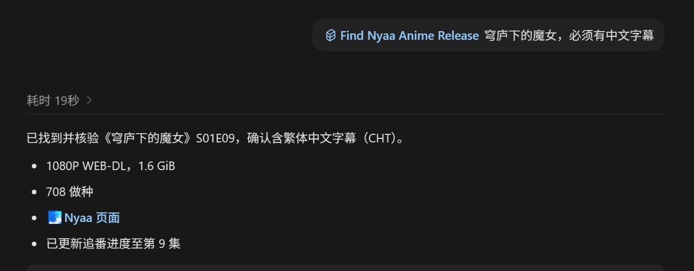
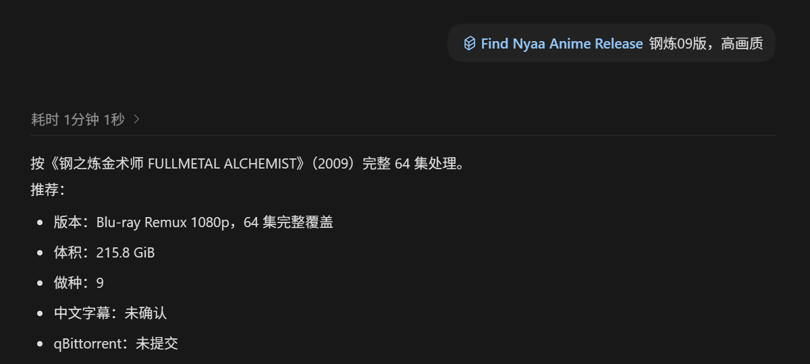

# 动漫搜索与自动追番

用自然语言查找 Nyaa 动漫资源，筛选季集、画质和中文字幕，返回磁力链接，或按你的要求交给 qBittorrent 下载。

支持 DeepSeek Harness。无需安装 Codex，不绑定特定模型；需要宿主能读取文件、运行 Python，并访问相关网站。它是给 Agent 使用的工具和规则，不是在线播放软件，也不是另一个动漫资源站。

[下载安装包](https://github.com/divisioncassini05-lab/find-nyaa-anime-release/releases) · [项目源码](https://github.com/divisioncassini05-lab/find-nyaa-anime-release) · [反馈问题](https://github.com/divisioncassini05-lab/find-nyaa-anime-release/issues)

## 可以帮你做什么

| 你的需求 | 插件的处理方式 |
| --- | --- |
| 只记得中文名、简称或别名 | 先确定作品，再使用合适的英文名或罗马字名查 Nyaa；真正有歧义时才询问 |
| 找新番下一集 | 读取本地追番进度，找对应的下一集；没有合格结果不跳集 |
| 找最新一集或指定集 | 区分最新、下一集和明确集数，不用旧集冒充目标集 |
| 找一整季、全系列或电影 | 核对合集覆盖与文件列表，排除缺集、错季及用单集冒充整季的结果 |
| 必须有中文字幕 | 根据标题、详情和文件证据核验，简体与繁体均可；没有证据不标记为已确认 |
| 不想手动添加下载 | 审核通过且获得下载授权后提交 qBittorrent，并核对客户端接受结果 |
| 按固定时间追番 | 使用 DSH 原生定时工具检查新集，按交付结果更新进度 |
| 查自己的 Bangumi 番单、评分和评价 | 按需读取收藏状态、进度及短评；可据此回答问题或推荐没看过的作品 |
| 不想手动填写 Bangumi 集数 | 页面点同步写入已核验的最新找到集数，整季任务点标记看过；找到或下载完成不自动代替确认 |

## 安装与第一次使用

### 从 npm 安装（推荐）

在 DSH「插件 → 添加插件」输入 `dsh-find-nyaa-anime-release`，选择 npm 官方注册表
`https://registry.npmjs.org/`。安装者无需 npm 账号。

从 npm 安装后，后续发布更高的兼容版本时，DSH 原生插件列表可以显示“可更新”。
已装最新版时不会显示这个提示。旧路径、Git 或压缩包安装需要一次性迁移来源，
详见 [更新已有安装](README.md#更新已有安装)。

### 安装发布包（备用）

1. 打开上方发布页，下载 `dsh-find-nyaa-anime-release-版本号.tgz`。
2. 把本地文件交给 DSH，告诉它：

```text
请通过当前 profile 的插件管理器安装这个插件包，确认技能能加载，然后做一次只读环境检查。
```

3. 按宿主提示重启或重新加载，在技能列表里确认 `find-nyaa-anime-release` 可用。

也可以在 CLI 中指定实际 profile 和文件绝对路径：

```sh
dsh plugin --profile web add "/absolute/path/dsh-find-nyaa-anime-release-0.2.3.tgz"
```

桌面版优先使用应用内当前 profile 的插件管理器。`web` 只是 CLI 示例，不能照抄后误装到另一套环境。

发布包已包含 Skill、Python 脚本、必要的随附解析器和许可文件，不需要构建。安装时没有自动执行的安装脚本，也不会替你安装 Python、开启 qBittorrent Web API 或修改网络设置。npm 与 GitHub 提供同一份校验过的安装包。

### 通过自定义市场索引安装

在 DSH 的 **Custom plugin indexes / Discover** 添加本项目的 [市场索引](https://raw.githubusercontent.com/divisioncassini05-lab/find-nyaa-anime-release/main/marketplace.json)，刷新后选择「动漫搜索与自动追番」。`0.2.2` 起索引使用对应的 npm 精确版本；这个地址后续保持不变。

这是作者维护的自定义索引，不代表已被官方或社区公共市场收录。只想本地安装时，使用上面的 `.tgz` 即可，无需添加索引。

### 先试一次只查

```text
用动漫搜索与自动追番，找《葬送的芙莉莲》第一季完整合集，只查资源，先不要下载。
```

首次使用会运行只读检查，确认 Python、时区数据和相关路径。缺少条件时会报告具体问题，不把“插件装好了”当成“无人值守下载已经配置好了”。

### 可选绑定 Bangumi

在动漫追番页面的设置中打开“连接 Bangumi”，从 [Bangumi 官方令牌页面](https://next.bgm.tv/demo/access-token) 获取 Token，填入配置窗口并验证。
纯终端环境可将 Access Token 保存到执行宿主的私密文件，只告诉 Agent 路径，或设置环境变量
`BANGUMI_ACCESS_TOKEN`。不要把令牌发到聊天里，也不要放进插件目录或 Git 仓库。
不绑定也能正常找番；Codex 与 DSH 需要分别配置凭据。

绑定后可询问在看列表、已看进度，或让 Agent 根据你看过的番、个人评分和收藏短评推荐。
数据按需读取与分页，不在每次检索时加载整个番单；未写的评价不会被猜成你的偏好。
明确说“第 6 集看完”只记第 6 集，“看到第 6 集”记 1–6 集，“全部看完”才记整部。
评分、短评、标签和隐私设置保持原样。目前不读取长篇日志评论。

绑定只增加辅助记账，Bangumi 收藏状态不会覆盖本地下一集、画质或下载策略。
页面计划由用户点击按钮同步进度：最新找到集数已可靠核验时，可覆盖至该集；最终集已确认则标记看过，不必等待下载结束。已同步且无新内容时按钮置灰，失败可重试。
非页面管理的聊天流程仍沿用客户端接受正篇单集后的记账约定，不代表实际播放完成；只查链接、失败、特典及整季/电影包不自动推断观看进度。同步失败不重复下载。

## 常用说法

### 找单集或合集

```text
找这部番的下一集，轻量观看，只给磁力。
找《某部动画》第二季第 3 集，必须有中文字幕。
找《某部动画》第一季全集，普通观看，先让我选版本。
找《某部动画电影》的高画质版本。
```

已追踪的新番直接说作品名，默认查下一集；明确说“最新”或指定集数时按你的要求。老番一般先提供少量已核验的合格选项，再交付你选中的版本；你已授权“按默认来”或指定版本时不会重复要求选择。

### 定时追番

```text
每周五晚上 22 点检查这部新番，找到合格新集就加入 qBittorrent。
这个定时任务只查资源、返回磁力，不要自动下载。
把这部番的追番任务改到每周六晚上，其他条件不变。
```

只有你要求时才创建任务。DSH 需提供 `schedule_create/list/view/edit`，执行宿主也必须在计划时间运行。关掉执行宿主不等于任务仍会在云端自动运行。

页面的定时安排支持每周选择星期、每天固定时间和指定日期预约一次，可选择时区；与宿主共用调度服务。整季任务只执行一次或预约一次，不创建逐集周期。原有小时周期保留兼容。

非页面聊天流程的自动补查适用于 **Asia/Shanghai 的单一每周时点**：暂时未更新时每隔 4 小时补查，最多 3 次，再恢复常规计划；不会擅自套用到其他复杂计划。

## 画质怎么选

| 档位 | 默认体积条件 | 用法 |
| --- | --- | --- |
| 轻量观看 | 正篇每集 1–2 GiB | 未指定档位时使用 |
| 普通观看 | 正篇每集 2–4 GiB | 可以直接说“一般画质”或“普通观看” |
| 高画质 | 正篇通常每集至少 6 GiB，或有证据的 BDMV、Remux 等无损来源 | 按实际片源证据审核，不凭名称直接判定 |
| 动画电影 | 默认总大小至少 10 GiB | 明确给出的体积条件优先 |

体积是筛选条件，不是画质评分。更大、HEVC、10bit 或某个发布组标签，都不能单独证明画面更好；还会结合详情与文件证据比较。

新番交互及定时任务会沿用保存的默认配置，其中可包含体积向上兼容。明确的上限始终有效，不会因为没找到或要求字幕就自动降低下限。整季包还要检查覆盖和正篇文件，不能用总大小平均值掩盖明显不合格的单集。

## 中文字幕怎么判断

- 默认将中文字幕作为偏好，不把“字幕尚未确认”直接当成不合格。
- 明确说“必须有中文字幕”后才进入硬性验证；简体和繁体都接受。
- `Multi-Subs`、中文配音、标题中出现中文或某个字幕组名称，本身不是充分证明。
- 页面访问失败、证据不完整时报告核验未完成，不等同于“确定没有中文字幕”。

以下截图来自原 Skill 在 **Codex** 中的使用示例，展示筛选结果类型；不是 DSH 界面截图，也不代表这些资源目前仍可用。截图已裁去磁力内容。





## 下载与进度

只查资源、只要磁力或不下载的指示优先。安装插件不会自行开始下载。

提交 qBittorrent 前会重新核对资源和审核证据；成功返回后再核对客户端回执。“已加入客户端”“下载完成”和“你已经看完”是三件不同的事。

本地进度记录的是 **已交付进度**：只返回链接不推进；失败、重复集、指定旧集、电影和特典不会错误推进新番正篇。中断时保留原操作的信息用于恢复，不随便重新提交另一份资源。

页面收件箱单独展示“已找到”“下载中/已下载”和“已同步”。整季任务核验到合格完整包后即归入已完成，下载状态单独保留；逐集下载历史核验实际文件和客户端完成凭据。同一作品合并记录，只有用户主动删除才移除计划，不删除下载文件。非页面聊天型追番沿用独立的完结清理流程。

## 数据保存在什么地方

| 系统 | 默认插件数据目录 |
| --- | --- |
| Windows | `%LOCALAPPDATA%/DSH/AnimeRelease` |
| macOS | `~/Library/Application Support/DSH/AnimeRelease` |
| Linux | `${XDG_DATA_HOME:-~/.local/share}/dsh/anime-release` |

可用 `ANIME_DSH_HOME` 指定其他绝对目录。多个 DSH profile 分别定时追番时应配置各自的数据目录，不能共用不同调度器的任务清单。

默认桌面下载目录为 `~/Downloads/Anime`，可用 `ANIME_DSH_DOWNLOAD_DIR` 或明确的命令参数覆盖。远程 Web API 的保存路径属于远程客户端所在机器，不能拿本机路径代替。

插件不自动读取或导入 Codex 的追番记录，不把个人进度、凭据或任务正文放入发布包。网络查询会访问资源和资料来源网站；模型调用由你的 DSH 与供应商处理。不要在任务正文、截图或反馈里公开账号密码。

## 环境与兼容性

| 项目 | 要求与当前边界 |
| --- | --- |
| DSH | 按 `0.2.2-rc.1` 接口适配；声明范围为 `>=0.2.2-rc.1 <0.3.0` |
| Python | 3.11+；Windows 缺 IANA 时区数据时需另装 `tzdata` |
| Node.js | CLI 宿主对应 24.9+；桌面版使用自己的宿主运行时 |
| 工具 | 技能加载、文件读写、终端；名称或排期核实时需要联网检索能力 |
| qBittorrent | 仅下载时需要；Windows 桌面启动，或显式配置 Web API |
| 远程/容器 | 脚本在执行宿主上运行；连接其他电脑需明确配置可达的客户端接口 |
| 定时追番 | 需要当前 DSH preset 提供原生定时工具，不能靠插件声明凭空获得权限 |

已完成离线回归、官方技能注册器加载/卸载、市场索引校验和独立目录安装检查。**尚未完成登录后的 DSH 桌面端真实定时下载验证**；macOS/Linux 路径有单元测试，但未完成这两端的桌面客户端实机测试。具体记录见 [BUILD-REPORT.md](BUILD-REPORT.md)。

## 常见问题

### 必须用 DeepSeek 模型吗？

不绑定模型品牌。使用当前 DSH 配置的模型，但它需要能够理解请求、调用工具并按证据审核结果；不同模型的效果和费用会有差异，插件不能保证相同体验。

### 找不到结果，是不是就没有资源？

不一定。作品身份不明确、网络失败、详情读取失败、目标集尚未发布和资源不达标是不同情况。报告会尽量区分；不要把检索范围内无合格结果理解成全网不存在。

### 能帮我下载外挂字幕、翻译或校轴吗？

这个插件核验发布是否带中文字幕，不提供外挂字幕翻译、OCR 或自动校轴，也不负责整理已下载的媒体库。

### 更新会清空进度或改变已有任务吗？

正常更新只替换代码和规则，数据保存在安装目录外，不自动改写已有定时任务。Codex Skill 和 DSH 插件一起维护，但两端个人记录互不自动同步。

### 能用图形界面吗？

`0.2.3` 的原生侧栏“动漫追番”采用追番收件箱与 Bangumi 番单双标签。添加时选择整季合集、最新一集或补齐未记录集数，再设置画质、字幕、下载要求与运行时间。
列表优先展示异常和新结果；展开分为本次结果、后续安排与资源要求。配置、筛选、定时管理和手动同步不需进入聊天，也不调用模型；查资源仍由 Agent 审核，不能绕过证据核验。
明暗双主题沿用手绘水下背景，窄窗口自动调整布局，动态可关闭。不勾选下载时只找资源，不伪造下载完成。


该图使用示例记录。面板已完成浏览器预览与宿主契约测试，登录后 DSH 桌面端实装仍待验证。
更新方法见 [安装与更新说明](README.md#更新已有安装)；项目自定义索引与 GitHub 发布包使用相同版本。

## 反馈与许可

提交问题时附上 DSH 版本、系统、Python 版本、原始请求及错误状态；先遮住密码、私人路径和不想公开的任务内容。[GitHub Issues](https://github.com/divisioncassini05-lab/find-nyaa-anime-release/issues)

项目自身代码采用 MIT 许可，随附组件保留各自许可。与 DeepSeek、OpenAI、Nyaa、qBittorrent 官方无关联。请仅检索与获取你有权访问的内容。
