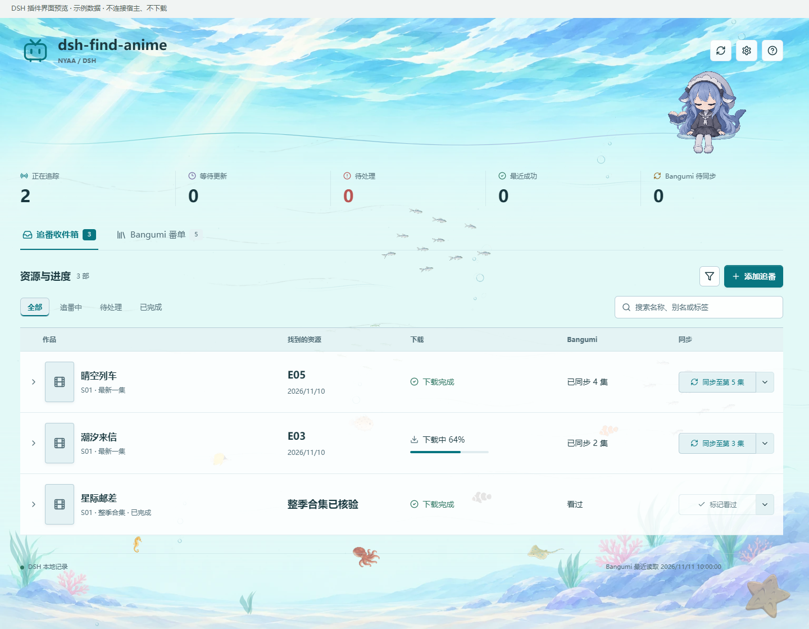
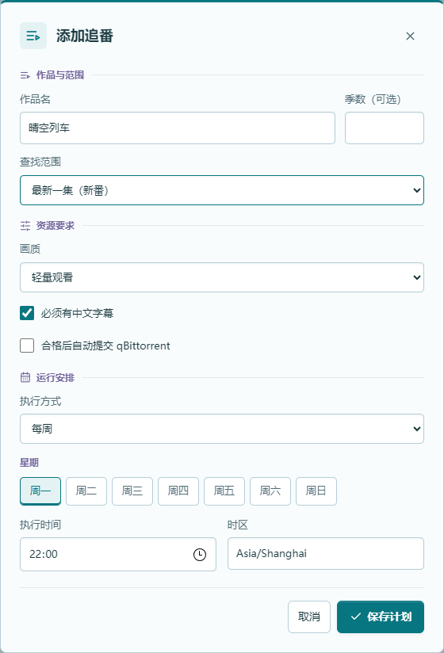
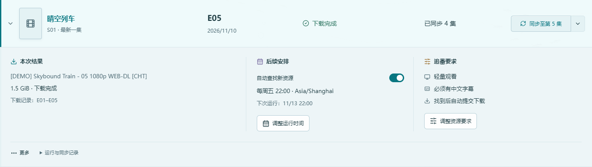
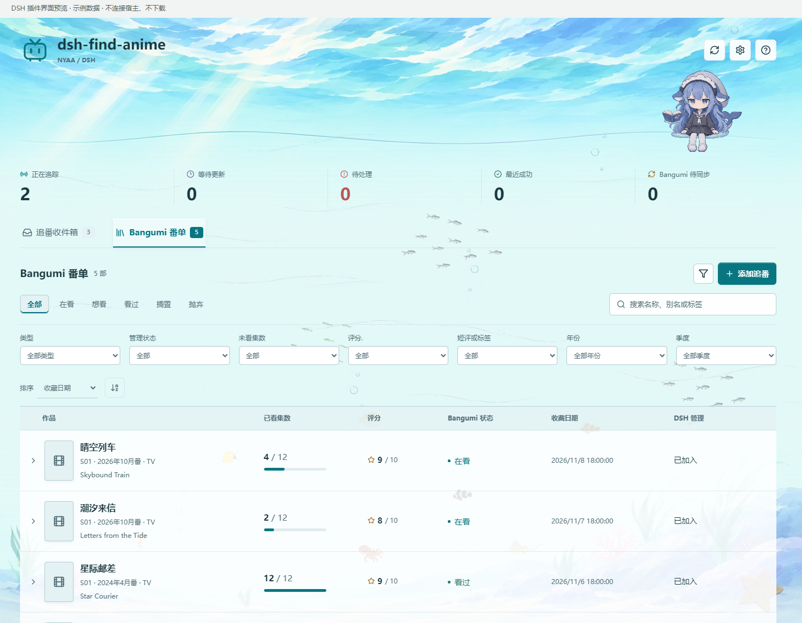
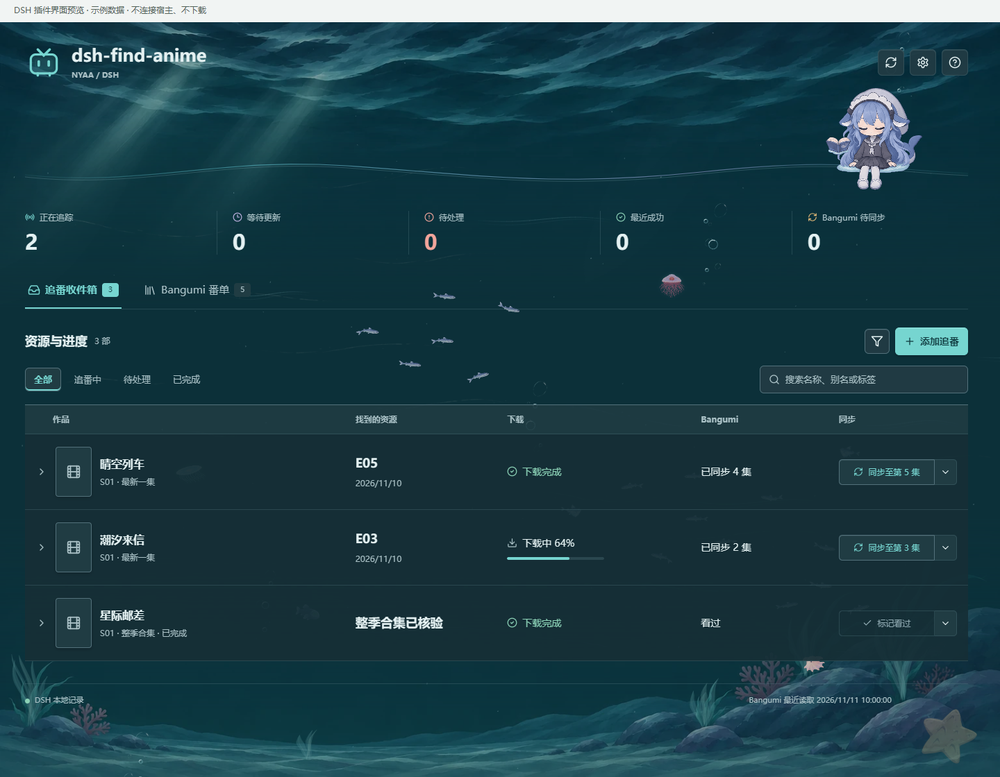

# dsh-find-anime

**动漫搜索、定时追番与整季补番。**

用自然语言查找 Nyaa 资源，按季集、画质和中文字幕要求筛选；通过追番收件箱查看资源结果与下载状态，联动 qBittorrent，并在需要时手动同步 Bangumi 观看进度。

[安装与更新](README.md#安装) · [项目源码](https://github.com/divisioncassini05-lab/find-nyaa-anime-release) · [发布包](https://github.com/divisioncassini05-lab/find-nyaa-anime-release/releases) · [反馈问题](https://github.com/divisioncassini05-lab/find-nyaa-anime-release/issues)

> 对外名称为 **dsh-find-anime**；安装时仍使用 **`dsh-find-nyaa-anime-release`**，已有用户的更新渠道不变。下方图片是当前插件组件的离线实拍，作品、评分和进度均为虚构演示数据，不是个人番单或真实检索结果。截图与本次发布的界面一致。



## 设好要求，之后看结果

添加作品时选好查找范围、画质、字幕要求和运行时间。之后在收件箱看新资源、下载到哪一步、有没有待处理事项；需要记到 Bangumi 时再点同步。

| 查找范围 | 适合什么时候用 |
| --- | --- |
| 最新一集 | 跟着新番更新，每次查最新已播正篇 |
| 补齐未记录集数 | 已经更新到第 5 集才开始追，查找本地尚未记录的集数 |
| 整季合集 | 补已完结的番，一次找完整一季；电影按整部处理 |

整季任务找到合格完整包后归入已完成，**不代表文件已经下载完**。下载状态另列显示，完成记录保留，只有主动删除才移除本地计划。

每周可选择星期和时间，也支持每天固定时间或指定日期预约一次。整季补番使用一次性任务，不会变成逐集周期追番。任务由 DSH 宿主调度，执行时需要宿主运行；关闭电脑后不会转到云端继续执行。

<p align="center"></p>

## 也可以直接在聊天里找

```text
找《某部动画》第二季第 3 集，必须有中文字幕，只给磁力。
找《某部动画》第一季完整合集，普通观看，先让我选版本。
每周五晚上 22 点查这部新番，合格后加入 qBittorrent。
```

支持中文名、简称、英文名与罗马字名。先确认作品身份，再使用适合 Nyaa 的名称搜索，区分季度、正篇、特典、剧场版和合集。确实有歧义时才询问；身份未确认、网络失败、尚未发布与资源不达标，不混为一句“没有资源”。

默认检索 Nyaa，其他资料站用于核实作品身份和排期，不擅自扩展为其他下载来源。老番通常提供少量已核验的合格选项，再按你的选择交付；明确指定版本或授权按默认处理时遵循你的要求。

## 画质和字幕，分别设要求

| 画质 | 默认体积条件 |
| --- | --- |
| 轻量观看 | 正篇每集 1–2 GiB，未指定时默认使用 |
| 普通观看 | 正篇每集 2–4 GiB |
| 高画质 | 正篇通常每集至少 6 GiB，或有证据的 BDMV、Remux 等无损来源 |
| 动画电影 | 默认总大小至少 10 GiB |

体积只是筛选条件，不是画质评分。更大的文件、编码标签或发布组名字，不能单独证明画面更好；会结合详情与文件证据核验。整季包还需检查覆盖范围和正篇文件，不以总大小平均值掩盖低于门槛的单集。

默认优先中文字幕；勾选或明确说 **“必须有中文字幕”** 后，才作为硬性条件验证，简体和繁体均可。多字幕标签、中文配音或字幕组名字本身不算充分证明。核验中断会报告检查未完成，不冒充已经确认无中文。

保存的要求可包含体积向上兼容；明确上限始终有效。检索失败或要求中文字幕不会自动降低体积下限。

## 下载和同步，不混为一件事

收件箱分别记录找到的资源、客户端提交、下载状态和 Bangumi 已看进度。找到资源后可以手动提交，也可在添加计划时启用自动提交 qBittorrent。只要磁力或明确不下载时，不会提交下载。

展开作品，只看本次结果、后续安排和资源要求。查找失败可以重试，下载提交失败可以恢复原操作，不必重新填一遍计划。



- **新番同步**：点击后按已核验的最新找到集数写入 Bangumi；确认是最终集时，同次操作标记看过。由你点击确认，不要求等下载结束。
- **整季补番**：主按钮为标记看过，旁边菜单可选搁置或抛弃。可靠总集数已确认时才补齐观看集数。
- **停止追番**：搁置、抛弃或标记看过会先停止后续定时；云端失败也不会擅自恢复任务或删除下载文件。
- **失败重试**：同步失败保留待同步状态；已同步且没有新进度时按钮置灰。本地计划和下载历史继续保留。

以上为 **DSH 页面计划** 的交互。非页面聊天型流程沿用各自的交付记账约定，详见[使用教程](skills/find-nyaa-anime-release/references/getting-started.md)。客户端接受下载不代表实际播放完成。

## Bangumi 番单，不只是在看

可读取想看、在看、看过、搁置和抛弃，按名称、别名或标签检索，按作品类型与状态筛选，按评分、收藏日期等排序。封面和作品资料来自可获取的元数据，缺失时显示占位或未知，不编造资料。



```text
看看我 Bangumi 在看哪些番。
我以前给这部番打了几分，写过什么短评？
根据我看过的番、评分和短评，推荐几部没看过的。
```

读取和推荐不会修改收藏，也不会自动把整个番单加入下载计划。页面任务启动时可将未看过的作品置为在看，观看进度则等待你手动同步。评分、短评、标签和隐私设置保持原样；目前读取收藏短评，不读取长篇日志评论。

Bangumi 是可选连接：不绑定也能搜索和下载，云端状态不会覆盖本地资源要求或下一集策略。

## 昼夜水下界面

白天是浅海水光与鱼群，夜晚切换为深海鱼和少量发光水母。海草、气泡、洋流与海洋雪做轻量动态，右上角角色保留阅读和互动动作。

环境表现位于内容与交互角色下方，不拦截页面操作；背景动态可关闭，并遵循系统减少动态设置。窄窗口自动调整列表和弹窗布局。主题与角色不参与搜索判断，也不会额外发起下载。



## 安装后怎么开始

1. 在 DSH 的插件管理器中添加 **`dsh-find-nyaa-anime-release`**，使用 npm 官方注册表。无需注册 npm 账号。
2. 按宿主提示重新加载，打开侧栏的动漫追番页面。
3. 在设置中按需连接 Bangumi、配置 qBittorrent，两者都可跳过。
4. 添加追番计划，或在聊天中说“使用动漫搜索技能，只查资源，先不要下载”。

Bangumi Token 在[官方页面](https://next.bgm.tv/demo/access-token)生成，填入插件配置窗口；qBittorrent 地址、用户名和密码也在页面设置中填写。**不要把凭据贴进聊天、截图或公开仓库。**

从 npm 安装后可使用 DSH 原生更新检查。旧 Git、路径或压缩包安装的迁移方法见[安装与更新说明](README.md#更新已有安装)。发布到 npm 不等于公共市场已收录，收录状态以市场实际结果为准。

## 使用前需要知道

| 项目 | 要求或边界 |
| --- | --- |
| DSH | 当前声明 `>=0.2.2-rc.1 <0.3.0`，具体测试范围见构建报告 |
| 运行环境 | Python 3.11+；Node.js 24.9+，桌面端使用宿主运行时；Windows 缺时区数据时需安装 `tzdata` |
| 模型与工具 | 不绑定模型品牌，需要技能加载、文件、终端与联网工具能力；检索效果和费用依赖所用模型与网络 |
| 下载 | 仅下载时需要 qBittorrent；支持 Windows 桌面客户端或已配置的 Web API |
| 定时 | 使用 DSH 原生调度，宿主和相应工具权限需要可用 |
| 数据 | 凭据、追番记录和计划保存在安装目录之外；不自动导入 Codex 个人记录 |

配置、筛选、定时管理和页面手动同步不调用模型，资源检索仍需 Agent 审核证据。本插件不提供在线播放、外挂字幕翻译、OCR、校轴或媒体库整理，也不保证全网资源完整覆盖。

插件不会自动安装 Python 或下载客户端，不修改代理、防火墙，也不会自行开放 Web API。远程部署时下载目录属于远程客户端，不能直接套用本机路径。

本页配图使用隔离组件预览，不是登录后的宿主端到端测试。Windows、macOS/Linux 与定时下载的实际验证边界见 [BUILD-REPORT.md](BUILD-REPORT.md)，不要将声明兼容范围理解为每个平台均已实机验证。

## 反馈与许可

反馈时附上 DSH 与插件版本、系统、请求和错误状态，遮住密码、私人路径与账号信息。[提交问题](https://github.com/divisioncassini05-lab/find-nyaa-anime-release/issues)

项目代码采用 MIT 许可，随附组件保留各自许可。与 DeepSeek、OpenAI、Bangumi、Nyaa、qBittorrent 官方无关联。请仅检索与获取你有权访问的内容。
