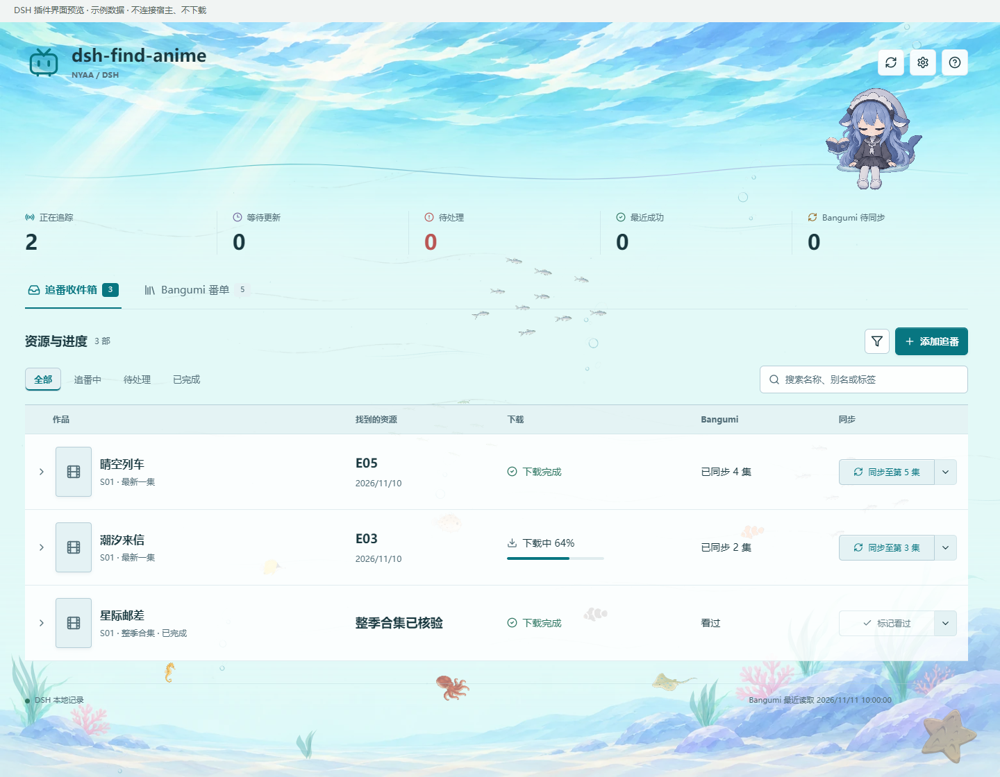
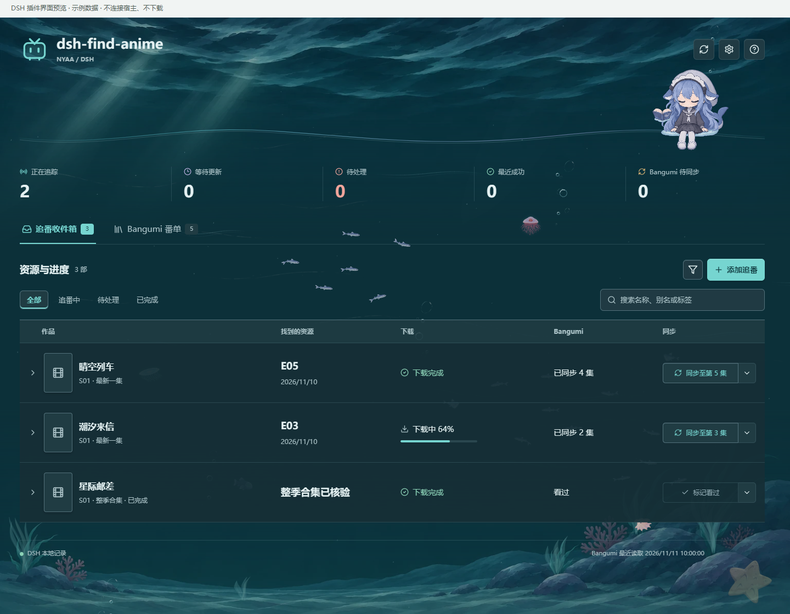

# dsh-find-anime · 动漫搜索与追番管理


[完整功能介绍与使用说明](DETAILS.zh.md) · [GitHub 发布包](https://github.com/divisioncassini05-lab/find-nyaa-anime-release/releases)

动漫资源搜索与追番管理：支持最新单集、补齐缺集与整季补番，按画质和中文字幕要求筛选 Nyaa 资源；提供定时追番、qBittorrent 下载联动与追番收件箱，可读取 Bangumi 番单并手动同步页面计划的观看进度。附带昼夜水下主题、动态鱼群与互动角色。

对外名称为 `dsh-find-anime`，安装包仍为 `dsh-find-nyaa-anime-release`，已有安装和更新渠道不变。



[查找范围与定时](DETAILS.zh.md#设好要求之后看结果) · [画质与字幕](DETAILS.zh.md#画质和字幕分别设要求) · [Bangumi 番单](DETAILS.zh.md#bangumi-番单不只是在看) · [夜间主题](DETAILS.zh.md#昼夜水下界面)

第一次使用？先看 [使用教程与常用说法](skills/find-nyaa-anime-release/references/getting-started.md)，或直接对 Agent 说“使用教程”。

将 `find-nyaa-anime-release` 的作品核验、整季/单集筛选、中文字幕检查和 qBittorrent
交付流程打包为 **DeepSeek Harness 原生技能插件**。安装后可直接用自然语言调用。

这是独立的 DSH 适配包，不需要先安装 Codex，也不会读取你的 Codex 追番记录。
模型负责理解与审阅，Python 脚本负责取证、校验和交付；体积大不等于画质一定更好。

## 能做什么

- 原生侧栏“动漫追番”：查看 DSH 追番记录、交付进度、下一目标和待核验操作；筛选与刷新不调用模型。
- 双标签区分 DSH 本地计划与 Bangumi 全部番单；配置连接在页面内完成，资源操作保留 Agent 审核与交付流程。
- 从全名、别名与当前对话确认具体作品、季和集，不把外传当正篇。
- 查下一集、最新集、指定集、完整一季或电影，核对 Nyaa 详情与文件列表。
- 按轻量观看、普通观看、高画质筛选；默认正篇最低 1 GiB/集，电影最低 10 GiB。
- 可硬性要求中文字幕；只有证据支持才标记已确认，不把中文配音或组名当字幕证明。
- 返回可复制磁力，或在获得授权后交给 qBittorrent。只查/只要链接不会提交下载。
- 使用 DSH 自带定时工具追番；按真实客户端接受回执推进，遇到未出/失败不跳集。
- 可选连接 Bangumi，查询个人番单、评分与短评、辅助推荐，并同步明确看完或已交付的追番正篇单集；不改变本地找番决策。

## 环境要求

| 组件 | 要求 |
| --- | --- |
| DSH | 面向 `0.2.2-rc.1` 接口制作；声明支持 `>=0.2.2-rc.1 <0.3.0`，未来版本仍需验证 |
| Node.js | DSH 对应环境，24.9+；桌面端使用自己的宿主运行时 |
| Python | 3.11+，终端可运行 `python` / `python3` / `py -3` |
| Agent 工具 | 技能加载、文件读写、终端；名称/排期疑难时需要联网检索 |
| 网络 | 执行 DSH 的机器能访问 Nyaa 及需要的作品资料来源 |
| qBittorrent | 仅实际下载需要；Windows 桌面模式，或已配置的 Web API |
| 定时追番 | 当前 preset 提供 `schedule_create/list/view/edit`，且宿主在计划时运行 |

插件不自动安装 Python/qBittorrent，不开放 Web API，不修改代理、防火墙或模型选择。
没有下载客户端仍可检索和返回链接。Windows 若缺 IANA 时区数据，定时功能需要安装
`tzdata`；只读检查会提示，不能因此假称已完成无人值守配置。

## 安装

### 从 npm 安装（推荐）

本版本为 `0.2.11`。在 DSH「插件 → 添加插件」输入：

```text
dsh-find-nyaa-anime-release
```

选择 npm 官方注册表 `https://registry.npmjs.org/`。也可让 DSH 的 Agent 通过
当前 profile 的插件管理器安装这个包。普通使用者不需要 npm 账号。
[npm 包页面](https://www.npmjs.com/package/dsh-find-nyaa-anime-release)。

这种安装方式可以使用 DSH 原生版本检查：发布更高且兼容的版本后，刷新插件列表会
显示可更新。已经安装最新版时不会显示更新提示。镜像站可能延迟同步。

### 本地插件包（备用）

从 [GitHub Release](https://github.com/divisioncassini05-lab/find-nyaa-anime-release/releases/tag/dsh-v0.2.11) 下载
`dsh-find-nyaa-anime-release-0.2.11.tgz`，交给 DSH，并说：

> 请通过当前 profile 的插件管理器安装这个本地插件包，完成后确认技能可加载。

也可以在 DSH CLI 中使用实际 profile 和本地绝对路径：

```sh
dsh plugin --profile web add "/absolute/path/dsh-find-nyaa-anime-release-0.2.11.tgz"
```

桌面端优先在应用内用插件管理器安装到当前 profile，不要照抄 `web` 去改另一个 profile。
源码 ZIP 解压后，插件管理器也可安装包含 `package.json` 的目录。不要只把 SKILL.md
复制进某个文件夹，否则会漏掉脚本及 DSH 调度适配。

更新已安装版本后按宿主提示重启。安装成功不等于运行成功：在技能选择器里确认
`find-nyaa-anime-release` 可用，然后运行一次只查请求。若宿主返回版本不兼容，
不要删掉版本声明强行安装，先核实接口变化。

### 更新已有安装

- npm 安装：刷新插件列表，在插件详情的版本区更新。包名保持不变。
- 项目自定义市场：[索引地址](https://raw.githubusercontent.com/divisioncassini05-lab/find-nyaa-anime-release/main/marketplace.json)
  保持不变，`0.2.2` 起安装来源为对应的 npm 精确版本。
- 旧版路径、Git 或 `.tgz` 安装不会自动变成 npm 安装，也不显示原生注册表更新提示。
  迁移时先保留当前 profile 的配置和外部数据，再用插件管理器把同名依赖替换为
  `dsh-find-nyaa-anime-release@0.2.11`，保留启用状态并按宿主要求重载。
  若界面拒绝同名安装，可先移除插件再从 npm 添加；不要删除数据目录或定时任务。
- 仍使用本地包时，需要手动下载新版 `.tgz` 并更新同名插件。不要只替换 `SKILL.md`；
  脚本、面板和宿主适配必须一起更新。
- 更新不会自动迁移 Codex 的记录或授权。已有 DSH 数据和定时任务保留；Bangumi
  凭据在 DSH 执行宿主中单独配置。同机可显式引用已有的私密令牌文件。

本索引由项目维护，不代表已被官方或社区公共市场收录。

### 调用例子

```text
用 find-nyaa-anime-release 找这部番的下一集，只返回磁力。
找某作品第一季完整合集，普通观看，必须有中文字幕。
每周五 22 点检查这部在播作品，有合格新集就加入 qBittorrent。
```

初次安装可让 Agent 进入技能资源目录执行 `python scripts/dsh_doctor.py`。
它只检查本地前置条件，**不联网、不启动客户端、不下载、不修改记录**。

## 图形面板（0.2.11）

本次加入已确认的阅读连点：阅读时在约1.2秒内点三次，等书页落稳后合书、抱书并闭眼回避；水幕遮住角色期间播放重新开书的动作，散开时回到原阅读。单击仍有原来的轻微涟漪反馈；只有阅读状态识别这套连点动作。暂停、隐藏和减少动态设置仍有效，不会因连点新增检索或下载操作。

海洋背景保留同一幅水面与海底构图，新增独立环境动画：19类生物、22种外观使用原生帧图集播放，白天以浅海小鱼群为主，夜晚改为深海鱼与少量水母。同类可聚集、异类提前避让，胆小生物绕行，个体从屏外进入并游出；没有捕猎或写实生态模拟。水母和鮟鱇鱼只在自身附近柔和发光。

海草根部贴合原画、叶尖错相轻摆；海床水光在白天稍明显、夜晚很弱；海洋雪缓慢沉降，白天稀少、夜晚略多，另有淡气泡与洋流。桌面白天上限40个环境生物、夜晚26个，手机为20/14；夜晚水母桌面最多2只、手机1只。全部跟随背景动态开关、页面可见性和系统减少动态设置。装饰层不拦截点击，始终低于普通环境鱼、女孩召唤鱼、女孩与页面内容；女孩及其召唤模块、坐点和现有图层未改动。

原有召唤与水效保持：检查动作须等待阅读、放书或小动作结束并回到稳定静坐后进入；召唤鱼完整轮廓保持在当前可见水域上方70%高度内，窗口缩小时重新约束轨迹。指尖循行保留已确认的修复素材和透视水效，透明角色按钮不增加背景或阴影。

小鲸鱼在静坐或阅读时，每隔约 25–45 秒稳定播放时间随机做一个小动作：轻晃脚尖、整理袖口、拨弄水珠、指尖循行或托腮思索。指尖的蓝色水珠逐渐变成黑色墨滴；拨水效果独立于人物。动作会等到自然衔接点才开始，不打断翻页。暂停背景动态、页面不可见或系统启用减少动态时一起暂停。小动作不调用模型、不联网、不触发业务操作。

安装并按宿主提示重载后，支持 Client UI 的 profile 会注册侧栏“动漫追番”。
纯终端或无 Client 服务的环境仍提供原来的 Skill，不强制安装 UI 服务。



- 页面分为 **追番收件箱** 和 **Bangumi 番单** 两个标签，默认打开收件箱；本地下载和云端观看进度分开显示。
- 收件箱默认优先展示异常和新结果，列表直接显示找到的资源、下载状态和已同步进度。
- “最近成功”统计近 30 天存在已提交交付回执的作品；任务触发或进入队列本身不算成功。
- Bangumi 番单读取想看、在看、看过、搁置和抛弃等全部记录，并支持按作品名、原名、别名或标签检索。
- Bangumi 番单的类型、状态、是否由 DSH 管理等属于筛选条件；收藏日期、最近更新、评分、名称和集数属于排序条件。
- 展开记录分为“本次结果、后续安排、追番要求”。下载失败直接重试同一份已核验资源，不重新调用模型找番。资源要求和运行时间分别保存，不互相修改。
- “自动查找新资源”开关只控制后续自动任务，不暂停下载、不修改 Bangumi；“现在查找一次”使用独立任务，不消耗或恢复原来的预约。读取状态、修改配置和手动同步不调用模型。
- 定时计划使用 DSH 原生调度服务，因此也会出现在宿主的通用“自动化任务”中；追番列表仍是创建、修改、暂停和恢复它们的主要入口。
- “定时安排”支持每周选择一个或多个星期、每天固定时间，以及指定日期时间仅执行一次；时区可选。原有小时周期继续保留，不会自动改写。补番也可预约一次，预约前不提前检索。
- “连接 Bangumi”和“配置 qBittorrent”在插件内打开配置窗口，不把 Token、密码或本机路径放进聊天草稿。
- 本地记录损坏、需要迁移或读取超时会显示错误，不假装为空列表，也不擅自修改文件。
- 导入 Bangumi 番单不会自动搜索或下载；只有明确开始由 DSH 管理后才建立本地计划。
- 水下背景配合统一的列表、表单、状态色和图标；支持明暗主题、窄窗口和减少动态。装饰不拦截操作，不改变宿主侧栏样式。

本版提供独立浏览器界面检查脚本与原生 Cordis 生命周期测试；实际登录后的 DSH 桌面端仍需按宿主版本验证。
预览使用与插件相同的面板组件，但只包含示例记录，不会读取真实番单或下载客户端。

## 数据与兼容性

### Bangumi（可选）

在图形面板点击“连接 Bangumi”或“配置 qBittorrent”即可打开对应配置窗口，配置均可跳过。
Token 和密码只提交给宿主端保存和验证，不经过聊天，不读取 Codex 凭据。

到 [官方令牌页面](https://next.bgm.tv/demo/access-token) 创建 Access Token。
插件内配置窗口不依赖 Python Tk；纯终端环境仍可使用
私密令牌文件或 `BANGUMI_ACCESS_TOKEN`，只向 Agent 提供文件路径。

可问“在看列表和进度”“根据我看过的番、评分和短评推荐几部”，或说“这部番第 6 集看完了”。
查询按需筛选、分页，不为每次找番加载全部收藏；当前读取收藏短评，不读取长篇日志。
聊天型流程中，已核验接受的追番正篇单集按约定记为已看，链接查询和添加失败不写回；页面管理的计划则始终由用户点击按钮同步进度。
整季/电影不自动推断逐集观看，可明确说看完后写入。
读取 Bangumi 的进度或收藏状态不会自动改变本地下一目标、画质或下载策略；用户在计划上明确选择搁置、抛弃或标记看过则先停止后续定时。断网时同步待重试，下载结果仍有效。

详情及命令见随包 [Bangumi 使用说明](skills/find-nyaa-anime-release/references/bangumi-sync.md)。

### 本地隔离

- 脚本随包安装，所有证据、进度和恢复日志放在包目录外，更新和卸载不会抹掉它们。
- Windows 默认数据目录 `%LOCALAPPDATA%/DSH/AnimeRelease`；macOS、Linux 使用对应的用户数据目录。
- `ANIME_DSH_HOME` 可指定绝对数据目录；默认目录适合单一 profile。多个 profile 做定时追番时必须分别配置，不能用一个 profile 的任务清单证明另一个没有任务。
- 默认桌面下载目录 `~/Downloads/Anime`；`ANIME_DSH_DOWNLOAD_DIR` 可覆盖。
- qBittorrent 凭据保存在执行宿主的私密配置中，也可通过环境变量覆盖，不写任务正文。
- Bangumi 凭据引用和个人番单缓存保存在包外；公共发布不包含令牌、评论或观看历史。
- 远程/容器 DSH 只能直接控制其所在机器；要操作另一台电脑的客户端，应显式配置可达的 Web API。
- 当前自动补查规划器只优化 Asia/Shanghai 的单一每周时点。其他 DSH 计划可保留运行，但不会擅自转换时区、套用补查或创建额外任务。
- DSH 未开放定时工具时，交互查询仍可使用；定时及需要任务读回的自动清理会停止并报告缺少能力。

详细适配边界与验证范围见 [COMPATIBILITY.md](COMPATIBILITY.md)。这不是 DSH 官方插件，
也不是播放软件；只能用于你有权获取的内容。第三方站点、种子活跃度及模型判断会影响结果。

## 维护与上架

### 计划操作

- DSH 计划保留已完成的记录，不会因找到资源或完成下载自动删除。
- 新番主按钮显示“同步至第 N 集”，补番为“标记看过”；旁边的下拉只提供搁置、抛弃。没有新内容时主按钮置灰，云端失败时重试原操作。
- 执行任务时自动将未看过的作品置为在看，已看过的不回退。进度仍需点击同步，按最新找到的集数覆盖中间集数；确认是最终集时同一次点击标记看过，无需等待下载结束。
- 整季任务找到并核验合格合集后直接进入“已完成”，不计入“正在追踪”；下载状态单独显示。逐集任务的下载历史仍核验实际文件和客户端完成凭据，同一作品合并。标记看过、搁置、抛弃后仍保留，只有主动删除才移除计划。搁置、抛弃和标记看过先停止后续定时，再写回云端。
- 标记看过会尝试补齐已确认的正篇章节；范围不明或写回失败显示部分完成，可直接重试。评分、短评和标签不变。
- 查找范围统一为“整季合集”“最新一集”“补齐未记录集数”。整季合集一次寻找完整目标季（剧场版为整部电影），可立即执行或预约；后两种可设置周期。最新一集直接找最新已播正篇；补齐模式按本地已核验资源记录找出截至最新已播的全部缺集，保留每集结果和下载状态，后续只补缺口，不用最高集数掩盖中间缺集。下载仍遵守原有授权与核验规则。
- 番单封面直接读取公开封面地址；类型与首播资料按需补全并缓存，无法读取时保留占位与未知状态。
- 展开只显示本次资源结果、后续安排与追番要求，低频运行和同步记录折叠；短评和标签在 Bangumi 番单查看。已提交下载不冒充下载完成；资料或画质要求变更后，旧资源必须重新核验才能再次提交。单次预约执行后，改要求或重新启用计划不会重复触发，重新选择未来时间才会再次预约。
- Bangumi 番单加载不阻塞本地计划。断网时保留同账号上次完整缓存并明确标示，连接弹窗显示读取进度和错误；断开连接不会删除本地计划或下载文件。
- 更换作品或季数需新增计划，避免混用旧进度和下载历史；原计划的画质、字幕要求和检查周期仍可修改。
- 断网后成功同步会清除已失效的待同步提示；新发生的失败和未补齐的集数仍会明确提示。

源码中 `overlays/` 和 `tools/sync_skill.py` 保存适配逻辑，`skills/` 是已包含全部脚本的
可安装快照；来源文件哈希记录在 `UPSTREAM.json`。更新上游后可重新构建：

```sh
python tools/sync_skill.py --source "/absolute/path/find-nyaa-anime-release"
npm ci --ignore-scripts
npm run build
npm test
python -m pytest tests/test_dsh_adapter.py skills/find-nyaa-anime-release/tests -m "not live" -p no:cacheprovider
npm pack --ignore-scripts
```

安装包无生命周期脚本、无 npm 运行时依赖，不会下载一个未知版本的 skill。
预构建客户端通过 DSH ModuleLoader 加载，共用宿主 React；构建依赖仅在开发时安装。
开发预览：`npm run build` 后运行 `npm run preview`，打开 `http://127.0.0.1:4319`。
预览只含示例数据，不访问真实追番记录或下载客户端。
`.tgz` 不含测试和 Python 字节码；源码 ZIP 另外提供测试、适配覆盖文件和构建工具。
本次实际验证记录见 [BUILD-REPORT.md](BUILD-REPORT.md)。
维护发布时同步 Codex、DSH、npm 与项目索引；步骤见 [MARKETPLACE.md](MARKETPLACE.md)。
npm 发布和自定义索引可用不代表已被社区公共市场收录。

基础 skill：[divisioncassini05-lab/find-nyaa-anime-release](https://github.com/divisioncassini05-lab/find-nyaa-anime-release)。
本插件沿用 MIT 许可；随附的 Python 依赖和身份目录保留各自许可文件。
